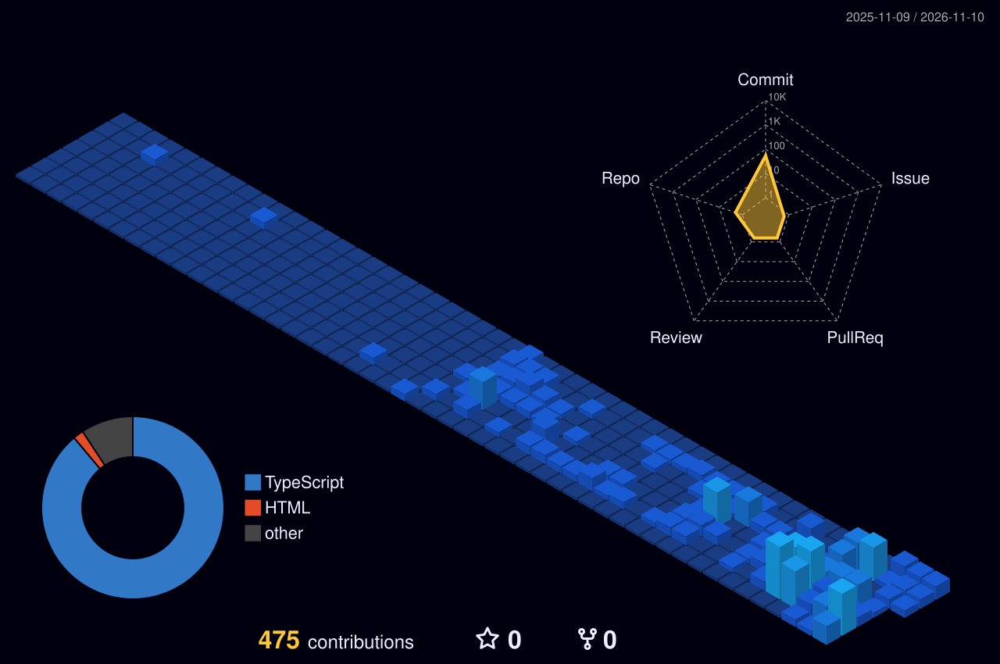

  

  <a href="#selected-work">WORK</a> &nbsp; / &nbsp; <a href="#engineering-toolkit">STACK</a> &nbsp; / &nbsp; <a href="#contribution-activity">ACTIVITY</a> &nbsp; / &nbsp; <a href="#connect">CONNECT</a>

Full-stack developer based in Brazil, studying **Science & Technology at UFABC**. I work across product interfaces, backend systems and mobile — with hands-on projects in **IoT and computer vision**.

## Selected work

**01 / [AQUALITY](https://github.com/erickk-silva/aquality-app)**  
IoT water-quality monitoring, from ESP32 sensors to a mobile experience.  
`React Native` · `TypeScript` · `ESP32` · `PHP`

**02 / [InScreenLock](https://github.com/erickk-silva/InScreenLock)**  
Privacy-first Android app with local processing and explicit permissions.  
`Kotlin` · `Jetpack Compose` · [Live site](https://erickk-silva.github.io/InScreenLock/)

**03 / SeeMe**  
Assistive computer vision for gesture-based interaction. Contributed to CNN training experiments and integration.  
`Python` · `OpenCV` · `MediaPipe` · *Collaborative / private codebase*

## Engineering toolkit

<picture>
  <source media="(max-width: 640px) and (prefers-reduced-motion: reduce)" srcset="./assets/toolkit-mobile-static.svg">
  <source media="(prefers-reduced-motion: reduce)" srcset="./assets/toolkit-columns-static.svg">
  <source media="(max-width: 640px)" srcset="./assets/toolkit-mobile.svg">
  
</picture>

Technologies · text version

**Web & mobile:** TypeScript, React, React Native, Next.js, Inertia.js, Kotlin, Jetpack Compose.  
**Backend & data:** PHP, Laravel, Node.js, NestJS, SQL Server, MySQL, Redis.  
**AI & vision:** Python, OpenCV, MediaPipe, CNN experiments, introductory fine-tuning.  
**Systems & quality:** Docker, Linux, GitHub Actions, PHPUnit, Jest, ESP32, C/C++.

## Contribution activity

  

Generated daily · [GitHub Actions](./.github/workflows/profile-3d.yml)

## Connect

[GitHub](https://github.com/erickk-silva) &nbsp; / &nbsp; [InScreenLock website](https://erickk-silva.github.io/InScreenLock/) &nbsp; / &nbsp; [Instagram](https://www.instagram.com/_erickksilva)
