  

  <a href="#selected-work"><strong>SELECTED WORK</strong></a> &nbsp;·&nbsp; <a href="#how-i-build"><strong>HOW I BUILD</strong></a> &nbsp;·&nbsp; <a href="#engineering-toolkit"><strong>TOOLKIT</strong></a> &nbsp;·&nbsp; <a href="#contribution-activity"><strong>ACTIVITY</strong></a> &nbsp;·&nbsp; <a href="#connect"><strong>CONNECT</strong></a>

### Hey, I'm Erick. I build things with purpose.

I'm a **full-stack developer** studying **Science & Technology at UFABC**, with interests spanning product engineering, systems, automation, applied AI and embedded technology. I enjoy going beyond implementation: understanding the problem, making sound technical decisions and validating what gets shipped.

  

## Selected work

Projects are the best way to explain the kind of engineering I care about. Here are two with public code and concrete product decisions.

**AQUALITY** — An end-to-end IoT and mobile project connecting water-quality sensors to a real-time monitoring experience. Built as a collaborative technical-school capstone project. [**Explore the code ↗**](https://github.com/erickk-silva/aquality-app)

**InScreenLock** — An Android-first, offline-first app for intentional screen time. Built around explicit permissions, local privacy, automated tests and documented architectural decisions. [**Source code ↗**](https://github.com/erickk-silva/InScreenLock) · [**Product website ↗**](https://erickk-silva.github.io/InScreenLock/)

## How I build

**Think in systems. Build for people. Validate with evidence.** I care about clear boundaries, maintainable architecture, pragmatic automation, and an interface that makes the complexity underneath feel simple. Whether a feature touches an API, an Android service or an embedded device, the goal stays the same: reliable behavior and a thoughtful user experience.

## Engineering toolkit

**Product & mobile:** React, React Native, TypeScript, Kotlin, Jetpack Compose. **Backend & data:** PHP, Laravel, MySQL, Microsoft SQL Server, APIs. **Systems:** Docker, ESP32, GitHub Actions, AI-assisted development workflows.

## Contribution activity

Night View · updated daily via <a href="./.github/workflows/profile-3d.yml">GitHub Actions</a>

<strong>More GitHub signals</strong> — repository activity and languages

 

  
  

## Connect

  <a href="https://github.com/erickk-silva"><strong>GITHUB</strong></a> &nbsp;·&nbsp; <a href="https://www.instagram.com/_erickksilva"><strong>INSTAGRAM</strong></a> &nbsp;·&nbsp; <a href="https://erickk-silva.github.io/InScreenLock/"><strong>INSCREENLOCK WEBSITE</strong></a>

Lightweight, self-hosted SVG assets. Subtle motion respects reduced-motion settings. No custom JavaScript, trackers or external fonts.
